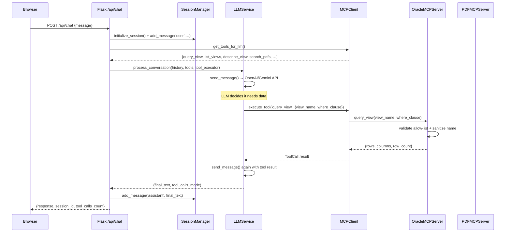

Now I have a thorough understanding of the entire codebase. Let me compile the full audit.

---

# AWDC Chatbot — Full Architecture Audit

## 1. Architecture: What the App Does and How It Works

### What It Is

This is a Flask chatbot that lets authenticated users ask natural-language questions and receive answers drawn from two live data sources: an Oracle APEX database (via allow-listed views) and a set of PDF documents. The Model Context Protocol (MCP) is used as the internal abstraction layer between the LLM and those data sources. It is deployed as a single serverless function on Vercel.

### Component Map

| File / Directory | Role |
|---|---|
| [`app.py`](app.py) | Local dev entry point — Flask app, all routes, service wiring |
| [`api/index.py`](api/index.py) | Vercel serverless entry point — identical logic, templates pointed one level up |
| [`config.py`](config.py) | Centralized `Config` class; reads all env vars, validates at startup |
| [`modules/llm_service.py`](modules/llm_service.py) | Talks to OpenAI or Google Gemini; manages tool-call loop |
| [`modules/mcp_client.py`](modules/mcp_client.py) | MCP orchestrator; holds `ServerConfig` list, discovers & executes tools |
| [`modules/oracle_mcp_server.py`](modules/oracle_mcp_server.py) | Oracle APEX adapter; allow-listed view queries via `oracledb` |
| [`modules/pdf_mcp_server.py`](modules/pdf_mcp_server.py) | PDF adapter; full-text keyword index via `pdfplumber`/`PyPDF2` |
| [`modules/apex_rest_handler.py`](modules/apex_rest_handler.py) | ORDS-compatible REST endpoints callable from APEX PL/SQL package |
| [`modules/session_manager.py`](modules/session_manager.py) | Conversation history stored in Flask `session` (cookie/filesystem) |
| [`modules/oauth2_manager.py`](modules/oauth2_manager.py) | OAuth 2.0 via Authlib; supports Google, GitHub, Facebook, LinkedIn, Auth0 |
| [`modules/activity_tracker.py`](modules/activity_tracker.py) | Privacy-preserving analytics to JSONL files in `analytics/` |
| [`modules/auth_decorator.py`](modules/auth_decorator.py) | `@require_auth` / `@require_api_auth` decorators guarding routes |
| [`modules/error_handler.py`](modules/error_handler.py) | Custom exception hierarchy + recovery strategies |
| [`modules/serverless_optimizer.py`](modules/serverless_optimizer.py) | Connection cache, lazy-load decorator, `/tmp` redirection for Vercel |
| [`modules/logging_config.py`](modules/logging_config.py) | Structured logging with optional JSON output |
| [`modules/apex_json_formatter.py`](modules/apex_json_formatter.py) | APEX-compatible JSON response shaping |
| [`apex/chatbot_pkg.sql`](apex/chatbot_pkg.sql) | PL/SQL package deployed in Oracle APEX; calls Flask via `APEX_WEB_SERVICE` |
| [`vercel.json`](vercel.json) | Routes all HTTP paths to `api/index.py`; 1 GB RAM, 10 s max duration |

### Data-Flow: Chat Message → Database Answer

**Key implementation details:**
- The tool-call loop in [`process_conversation()`](modules/llm_service.py:396) runs up to `max_iterations=5`.
- For **Gemini**, tools are skipped entirely — the LLM receives a plain prompt with no function-calling schema (see [`app.py:757`](app.py:757) and [`llm_service.py:552`](modules/llm_service.py:552)).
- For **OpenAI**, tools are passed as standard function-calling definitions.
- The `MCPClient` in [`mcp_client.py`](modules/mcp_client.py) holds `ServerConfig` objects pointing to HTTP endpoints (`MCP_ORACLE_ENDPOINT`, `MCP_PDF_ENDPOINT`). However, in practice the Oracle and PDF servers run **in-process** (instantiated directly in [`initialize_services()`](app.py:102)), not as networked HTTP servers. The `MCPClient` HTTP machinery goes unused in the current architecture.
- [`api/index.py`](api/index.py) and [`app.py`](app.py) are **near-identical duplicates** — Vercel requires `api/index.py` as its entry point.

---

## 2. Data-Model Summary

### Oracle APEX: `chatbot_pkg.sql`

[`apex/chatbot_pkg.sql`](apex/chatbot_pkg.sql) is a PL/SQL package deployed **inside Oracle APEX**. It acts as the APEX side of a two-way bridge:

| Function / Procedure | What it does |
|---|---|
| `process_message(p_message, p_session_id)` | Reads `CHAT_HISTORY` collection, calls `POST /ords/chatbot/api/chat` on Flask, stores response back in collection |
| `query_oracle_view(p_view_name, p_where_clause, p_limit)` | Calls `POST /ords/chatbot/api/query` |
| `search_documents(p_query, p_limit)` | Calls `POST /ords/chatbot/api/search` |
| `list_available_views` / `list_available_documents` | Calls `GET /ords/chatbot/api/views` and `/documents` |
| `initialize_chat_session` / `add_message_to_history` / `get_chat_history` / `clear_chat_history` | Manages an `APEX_COLLECTION` named `CHAT_HISTORY` (columns `C001`=message, `C002`=role, `D001`=timestamp) |
| `health_check` | Calls `GET /ords/chatbot/api/health` |
| `call_flask_api` (private) | Uses `APEX_WEB_SERVICE.MAKE_REST_REQUEST` to make all HTTP calls; hardcoded base URL `http://localhost:5000/ords/chatbot/api` |

> ⚠️ The base URL `c_flask_base_url CONSTANT VARCHAR2(200) := 'http://localhost:5000/ords/chatbot/api'` is hardcoded in the package constant — this will not work against the Vercel deployment URL.

### Oracle MCP Server: Allow-Listed Views Approach

[`modules/oracle_mcp_server.py`](modules/oracle_mcp_server.py) exposes **three MCP tools**:

| Tool name | What it does |
|---|---|
| `query_view` | `SELECT * FROM <view_name> WHERE <clause> ROWNUM <= <limit>` |
| `list_views` | Returns each view with its comment from `USER_TAB_COMMENTS` |
| `describe_view` | Returns column metadata from `USER_TAB_COLUMNS` |

Security model:
1. **Allow-list**: `ORACLE_ALLOWED_VIEWS` env var (comma-separated, uppercased). Any view not in the list is rejected before the connection is touched.
2. **Name sanitization**: [`_sanitize_view_name()`](modules/oracle_mcp_server.py:204) rejects any name with characters other than alphanumeric and `_`.
3. **Keyword blocklist on WHERE clause**: `DROP`, `DELETE`, `INSERT`, `UPDATE`, `TRUNCATE`, `ALTER`, `CREATE`, `GRANT`, `REVOKE` are checked (case-insensitive). The WHERE clause itself is concatenated into the query string, not parameterized — this is a SQL injection risk for any other injection vectors not in the blocklist.
4. **Row cap**: `MAX_RESULT_SIZE` (default 1,000).
5. **Connection pool**: `oracledb.create_pool(min=1, max=5)`.

### PDF MCP Server

[`modules/pdf_mcp_server.py`](modules/pdf_mcp_server.py) exposes three tools: `search_pdfs`, `get_document`, `list_documents`. It maintains an in-memory keyword index built from files in `PDF_STORAGE_PATH` (`./pdfs`). The index is persisted to `pdf_index.json`. Search is a simple bag-of-words keyword match with a relevance score (exact count × 2 + word-boundary count × 3). No semantic/vector search.

### Data Sources Summary

| Source | Type | Access method | Config env vars |
|---|---|---|---|
| Oracle APEX views | Relational (Oracle) | oracledb connection pool | `ORACLE_CONNECTION_STRING`, `ORACLE_USER`, `ORACLE_PASSWORD`, `ORACLE_ALLOWED_VIEWS` |
| PDF documents | Flat files | Keyword index in memory | `PDF_STORAGE_PATH`, `PDF_INDEX_FILE` |
| LLM (OpenAI / Gemini) | External API | HTTPS | `LLM_API_KEY`, `LLM_PROVIDER`, `LLM_MODEL` |

---

## 3. PII, Sensitive Data, and Privacy Handling

### Authentication: What's Stored Where

After a successful OAuth 2.0 callback ([`app.py:507`](app.py:507)), these values are written to Flask's server-side session:

| Session key | Value | Sensitivity |
|---|---|---|
| `session['user']` | Full dict: `id`, `email`, `name`, `picture`, `provider` | **PII** — real email and name |
| `session['access_token']` | OAuth provider access token | **Credential** — grants API access to provider |
| `session['token_expires_at']` | UTC timestamp float | Low |
| `session['login_timestamp']` | UTC timestamp float | Low |
| `session['conversation_history']` | Full message content (user + assistant) | **Sensitive** — may contain query data |

Flask session storage is `SESSION_TYPE = 'filesystem'` ([`app.py:78`](app.py:78)), which means session files live on disk. On Vercel (ephemeral filesystem), this is effectively memory-only per invocation. The session cookie is `HttpOnly`, `SameSite=Lax`, and `Secure=True` in production. The `SECRET_KEY` must be ≥16 chars (enforced by [`Config.validate()`](config.py:106)).

CSRF protection for OAuth is done via `secrets.token_urlsafe(32)` state + `secrets.compare_digest()` comparison in [`oauth2_manager.py:384`](modules/oauth2_manager.py:384). This is correct.

### Activity Tracker: What It Records and What It Does Not

[`modules/activity_tracker.py`](modules/activity_tracker.py) logs to daily JSONL files in `analytics/`.

**What it DOES record:**

| Event | Fields logged |
|---|---|
| `login` | hashed `user_id` (SHA-256), `provider`, ISO timestamp, hashed `ip_address` (SHA-256), `user_agent` string |
| `message` | hashed `user_id`, `session_id` (unhashed UUID), ISO timestamp, `user_agent` string |
| `logout` | hashed `user_id`, `session_duration` (seconds), `message_count`, `provider` |

**What it explicitly does NOT record:**
- Message content (enforced by the `log_message()` docstring comment: *"IMPORTANT: This method NEVER logs message content"*)
- The actual email or user ID — only their SHA-256 hash

**Privacy observations from the live `analytics/activity_2025-11-01.jsonl`:**
- `session_id` in message events is **not hashed** — it's a raw hex UUID (e.g., `727369bce34b31dea1e8261808b22d72`). This enables session-level message-count reconstruction.
- `user_agent` is logged in plain text — this is a minor fingerprinting risk.
- The IP address hashing uses **unsalted SHA-256**. This is not cryptographically strong anonymization (rainbow-table reversal is feasible for known IPv4 space).
- The analytics dashboard (`/admin/analytics`) has its admin gate **commented out** (see [`app.py:1024`](app.py:1024)): `# if not is_admin: return redirect(...)`. Any authenticated user can read all analytics.
- Multiple logout events in rapid succession in the test data suggest a bug where logout is triggered more than once per session (possibly from test automation).

### Credentials: How They Flow

All secrets live in environment variables, read in [`config.py`](config.py). [`Config.get_safe_config()`](config.py:198) masks them before logging. Oracle password is never logged. LLM API key shows only the first 4 chars. This is handled correctly for operational logging.

---

## 4. Prioritized Modernization List

### P1 — Critical / Blocking

**1. Eliminate the `app.py` / `api/index.py` duplication**

[`app.py`](app.py) and [`api/index.py`](api/index.py) are ~97% identical. Every bug fix and feature must be applied twice, and they already have diverged (Gemini tool-skip logic differs between them at lines 757–773 vs. 641–653). Refactor: move all route logic into a `create_app()` factory in [`app.py`](app.py) (or a shared `routes.py`), and have [`api/index.py`](api/index.py) call `from app import app` only.

**2. Fix the WHERE clause SQL injection risk in `oracle_mcp_server.py`**

[`query_view()`](modules/oracle_mcp_server.py:358) concatenates the LLM-generated `where_clause` string directly into SQL. The keyword blocklist at line 404 is not a sufficient guard — it misses `UNION`, `--` comments, semicolon injection, hex encoding, and many Oracle-specific vectors. The WHERE clause should be refused entirely (always `SELECT *` with no WHERE) and filtering pushed to the `limit` parameter, OR the server should accept parameterized `column=value` pairs that are assembled safely server-side.

**3. Add YugabyteDB (Postgres-compatible) MCP server**

Per the [`yugabyte-bob-brief-2026-10-18.md`](yugabyte-bob-brief-2026-10-18.md), the approved work plan is:
- Create [`modules/yugabyte_mcp_server.py`](modules/yugabyte_mcp_server.py) mirroring `OracleMCPServer` but using `psycopg` (v3, binary), connection from `YUGABYTE_HOST`, `YUGABYTE_PORT` (default 5433), `YUGABYTE_DBNAME`, `YUGABYTE_USER`, `YUGABYTE_PASSWORD`, `YUGABYTE_SSLMODE` (default `require`).
- Tools named `yb_list_tables`, `yb_describe_table`, `yb_query_table` with the same return shape as the Oracle tools.
- Allow-list from `YUGABYTE_ALLOWED_TABLES` — must support schema-qualified names (`awdc.laas_population_data`). The sanitizer must allow `.` in names.
- Wire in **both** [`app.py`](app.py) and [`api/index.py`](api/index.py) (lines ~152 and ~154 respectively).
- Register in [`mcp_client.py`](modules/mcp_client.py) as `ServerConfig(name='yugabyte', type='yugabyte', …)`.
- Add `psycopg[binary]` to [`requirements.txt`](requirements.txt), `YUGABYTE_*` vars to [`.env.example`](.env.example).
- Update the LLM system prompt in [`llm_service.py:542`](modules/llm_service.py:542) to describe both backends so the model can route appropriately.

**4. Fix the hardcoded base URL in `chatbot_pkg.sql`**

[`apex/chatbot_pkg.sql:10`](apex/chatbot_pkg.sql:10) has `c_flask_base_url CONSTANT VARCHAR2(200) := 'http://localhost:5000/ords/chatbot/api'`. This points to localhost and will not resolve from Vercel or any deployed APEX environment. It should be parameterized via an APEX application-level substitution string or an APEX\_APPLICATION parameter, not a package constant.

### P2 — Important / Near-Term

**5. Wire the MCP in-process servers through the `MCPClient` properly, or remove the dead HTTP layer**

The `MCPClient` is initialized and its HTTP session/tool-discovery machinery exists, but `oracle_server` and `pdf_server` are **called directly** via `ApexRestHandler` — the HTTP `execute_tool()` path in `MCPClient` is never reached. The `available_tools` dict is always empty because `connect_servers()` is never called (skipped in [`initialize_services()`](app.py:177)). Either: (a) remove `MCPClient` and wire `ApexRestHandler` directly into the LLM service, or (b) make the in-process servers implement the same interface as an HTTP MCP endpoint so the `MCPClient` can use them directly. Currently the architecture has two parallel data paths that don't connect.

**6. Enforce admin-only access on the analytics endpoints**

The guard in both [`app.py:1024`](app.py:1024) and [`api/index.py:905`](api/index.py:905) is commented out. Any authenticated user can call `GET /api/analytics` and `GET /admin/analytics`. This should be uncommented and an `is_admin` claim added to the OAuth user profile (e.g., a whitelist of admin emails in env, or an Auth0 RBAC claim).

**7. Add HMAC salt to IP address hashing in `activity_tracker.py`**

[`_hash_identifier()`](modules/activity_tracker.py:57) uses unsalted SHA-256. IPv4 address space is small enough to be rainbow-tabled trivially. Add a server-side HMAC secret (`ANALYTICS_HASH_SECRET` from env) as a salt.

**8. Gemini tool-calling gap**

When `LLM_PROVIDER=gemini`, tool calls are disabled entirely ([`app.py:757`](app.py:757)). Gemini 1.5+ supports native function calling via `google-generativeai`. Either implement Gemini tool-call support or document the limitation clearly and gate the APEX/PDF features on provider.

### P3 — Framework / Quality Improvements

**9. LLM conversation history bug**

In [`app.py:780`](app.py:780), `process_conversation()` is called with `conversation_dict[:-1]` (excluding the just-added user message), but in [`api/index.py:660`](api/index.py:660) it's called with the full `conversation_dict` (including it). One of these is wrong. The Vercel entry point `api/index.py` is the production code — the current message should be included in the history passed to the LLM.

**10. Test coverage gaps**

Existing tests in `tests/` cover unit logic for `MCPClient`, `LLMService`, `OracleMCPServer`, `PDFMCPServer`, and `SessionManager`, plus integration tests. **Not covered:**
- `OAuth2Manager` — no test for the CSRF state validation path, token exchange, or user-info normalization per provider
- `ActivityTracker` — no test for `_hash_identifier` salt behavior, retention cleanup, or the concurrent-write race condition
- `ApexRestHandler` — no route-level integration test
- The `@require_auth` / `@require_api_auth` decorators
- Gemini vs. OpenAI branching in `process_conversation()`
- The `initialize_services()` cold-start / warm-start caching logic
- Any end-to-end test for the full chat → Oracle view → LLM response path

**11. Remove `SESSION_TYPE = 'filesystem'` for Vercel**

[`app.py:78`](app.py:78) sets `SESSION_TYPE = 'filesystem'`. Vercel's filesystem is ephemeral and not shared across instances, so session files created by one invocation are invisible to others. Flask's default signed-cookie session (no `SESSION_TYPE`) is the correct choice for Vercel. Alternatively, use Redis via `flask-session`. The current setting means conversation history silently vanishes between Vercel function invocations.

**12. Upgrade PDF search to semantic/vector search**

[`search_pdfs()`](modules/pdf_mcp_server.py:555) uses bag-of-words keyword matching. This produces poor recall for natural-language questions. For the modernization, use `sentence-transformers` or the OpenAI embeddings API to generate and store per-page embeddings in `pdf_index.json`, then retrieve by cosine similarity.

**13. Pin `vercel.json` memory and duration for Yugabyte**

[`vercel.json`](vercel.json) sets 1 GB RAM and 10 s max duration. Adding a Yugabyte connection (with TLS handshake) on cold start may exceed 10 s. Bump `maxDuration` to 30 s for the Vercel Hobby plan, or use the Pro plan for 60 s and consider a `/api/warmup` pre-warm cron.

### P4 — Nice-to-Have

**14. Replace `requirements.txt` with `pyproject.toml` + `uv`** — for reproducible builds and dev/prod dependency separation.

**15. Add structured request/response logging middleware** — currently `after_request` logs status code and duration but not the tool names used. Add tool_names to the response log for observability.

**16. Pagination on `query_view`** — currently results are hard-capped at `MAX_RESULT_SIZE=1000`. Add `offset` support so the LLM can page through large result sets.

---

### Priority Summary

| # | Item | Priority | Files |
|---|---|---|---|
| 1 | De-duplicate `app.py`/`api/index.py` | **P1** | [`app.py`](app.py), [`api/index.py`](api/index.py) |
| 2 | Fix WHERE-clause SQL injection | **P1** | [`modules/oracle_mcp_server.py`](modules/oracle_mcp_server.py:400) |
| 3 | Add YugabyteDB MCP server | **P1** | new file + [`app.py`](app.py), [`api/index.py`](api/index.py), [`modules/mcp_client.py`](modules/mcp_client.py), [`requirements.txt`](requirements.txt), [`.env.example`](.env.example) |
| 4 | Fix hardcoded APEX base URL | **P1** | [`apex/chatbot_pkg.sql`](apex/chatbot_pkg.sql:10) |
| 5 | Fix dead MCPClient HTTP layer | **P2** | [`modules/mcp_client.py`](modules/mcp_client.py), [`app.py`](app.py) |
| 6 | Admin gate on analytics | **P2** | [`app.py:1024`](app.py:1024), [`api/index.py:905`](api/index.py:905) |
| 7 | HMAC-salt IP hashing | **P2** | [`modules/activity_tracker.py`](modules/activity_tracker.py:57) |
| 8 | Gemini tool-calling | **P2** | [`modules/llm_service.py`](modules/llm_service.py), [`app.py`](app.py) |
| 9 | Fix conversation history bug | **P3** | [`app.py:780`](app.py:780) vs [`api/index.py:660`](api/index.py:660) |
| 10 | Fill test coverage gaps | **P3** | `tests/` |
| 11 | Fix filesystem session on Vercel | **P3** | [`app.py:78`](app.py:78), [`api/index.py:87`](api/index.py:87) |
| 12 | Semantic PDF search | **P3** | [`modules/pdf_mcp_server.py`](modules/pdf_mcp_server.py) |
| 13 | Bump Vercel timeout for Yugabyte | **P3** | [`vercel.json`](vercel.json) |
| 14–16 | pyproject, structured logging, pagination | **P4** | various |